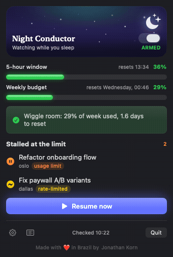
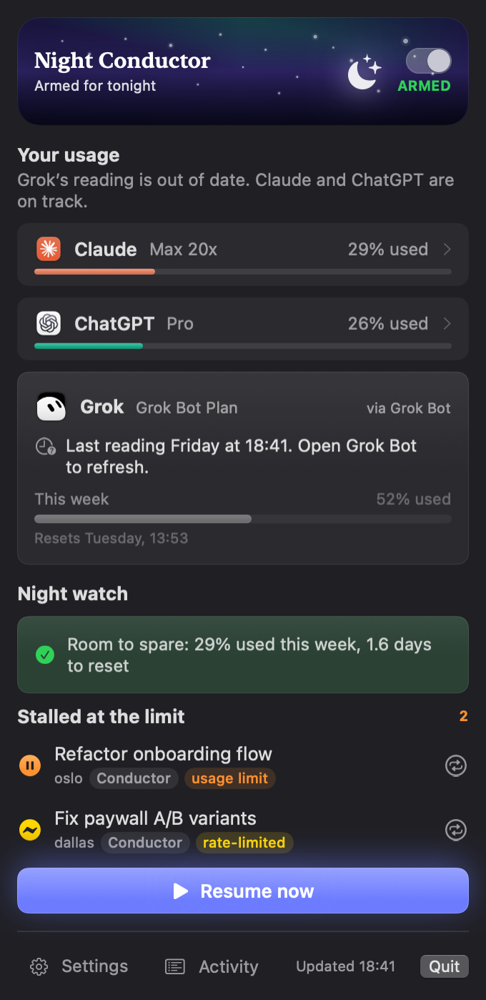
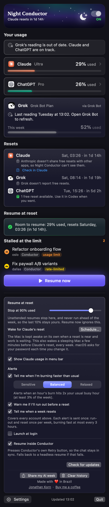
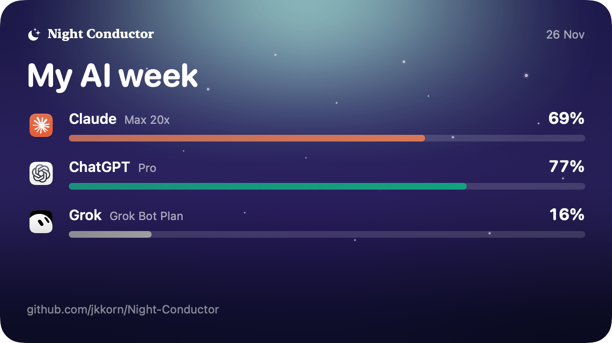

<p align="center">
  
</p>

<h1 align="center">Night Conductor</h1>

<p align="center">
  <strong>Your weekly Claude, ChatGPT and Grok usage, and when each one comes back.<br>
  When a <a href="https://conductor.build">Conductor</a> session stalls on the limit,
  Night Conductor resumes it at the reset, whatever the hour,<br>without spending the part of the week you keep for yourself.</strong>
</p>

<p align="center">
  
  
  
  
</p>

<p align="center">
  
</p>
<p align="center"><em>A moon lives in your menu bar. The header sky follows the real clock.</em></p>

---

Claude and ChatGPT plans are weekly now. When you hit the limit, the work
stops until the week resets, and that reset is a fixed moment: Friday at 01:59,
say. Not "tonight". Not "in five hours".

Night Conductor is a small macOS menu bar app built around that moment. It
shows where each of your weeks stands and exactly when each one comes back.
When a session stalls on the limit, it waits for the reset, then picks the
work back up by pressing the session's own Retry, so the chat stays in sync.

It is careful with your week on purpose. Unattended resumes stop at a line you
set (90% used by default) and never run ahead of the week, so the last part of
it is always yours.

## It works wherever you run Claude

Stalled sessions from all three places show up in one list, each one tagged by
where it came from and resumed the right way for that app.

| You run Claude in | Tag | How Night Conductor resumes it |
|-------------------|-----|--------------------------------|
| [Conductor](https://conductor.build) | `Conductor` | presses Conductor's own Retry, falls back to headless if that fails |
| The Claude desktop app (Cowork) | `Claude` | presses Claude Desktop's Retry, staying inside its sandbox |
| The terminal (Claude Code) | `Terminal` | runs `claude --resume` directly, which is exactly how you'd do it yourself |

If the same session shows up in more than one place, it only counts once.

## How a reset goes

Every few minutes, at any hour:

1. **It scans.** Reads the session databases (read only, it never writes back)
   for anything whose last message is a `429` usage-limit error.
2. **It checks the week.** Asks the official usage endpoint for your live
   weekly numbers, the same ones `/usage` shows in Claude Code, using the
   OAuth token Claude Code already keeps in your Keychain.
3. **It decides.** It only resumes when there's real room:
   - the week is under your stop line (90% used by default)
   - you aren't spending the week faster than it's passing. At 70% with five
     days left, it holds rather than leave you short on Thursday.
   - at the limit, it simply waits for the reset and tells you when that is.
4. **It resumes.** It presses Retry so the work continues right in the chat,
   one session at a time with a re-check after each. It stops at 3 resumes per
   session and 10 a day. If it can't read your usage, it does nothing, because
   guessing is how you blow a budget.

It keeps your Mac awake only when stalled work is waiting and the reset is
less than 30 minutes away (or resuming is already possible). Not all week.

## Resets, honestly

- **When each week comes back.** A Resets card lists every account, soonest
  first: "Sat, 03:13 · in 1d 14h". The menu header shows the next one.
- **A note when a week resets.** "Claude's week reset", once, from a fresh
  reading. Turn it off in settings.
- **Free resets.** ChatGPT reports them to its own Codex app, which Night
  Conductor asks, so you see the real count. Anthropic only shows Claude's
  free resets inside Claude, so the card says exactly that and links to your
  usage page. Night Conductor could pretend to be Claude Code to read them; it
  doesn't. And it never redeems a reset for you: that's your call.
- **Wake for the reset.** Optional: a weekly firmware wake a few minutes before
  Claude's reset, for a Mac that's asleep then. If a free reset moves your week,
  settings says so and offers to update it.

## Install

You'll need macOS 15 or newer, [Conductor](https://conductor.build), and
[Claude Code](https://claude.com/claude-code) signed in with a subscription.

**Download:** grab the zip from the
[latest release](https://github.com/jkkorn/Night-Conductor/releases/latest),
unzip it, and drag **Night Conductor.app** into Applications. The build is not
notarized yet, so macOS blocks the first launch. Clear that once:

```bash
xattr -dr com.apple.quarantine "/Applications/Night Conductor.app"
```

Or open System Settings, go to Privacy & Security, and click Open Anyway.

**Or build from source** (no warning at all):

```bash
git clone https://github.com/jkkorn/Night-Conductor.git
cd Night-Conductor/NightConductor
./build-app.sh
```

Drag `dist/Night Conductor.app` into Applications and open it. That's it. Then:

1. Click the moon in your menu bar.
2. Auto-resume at reset is on by default (the switch in the header).
3. The first time, allow Keychain access (click Always Allow) and grant
   Accessibility so it can press Retry inside Conductor.

Launch at login is on by default, so a restart never leaves stalled work
waiting. Turn it off in settings if you prefer.

## The interface

<p align="center">
  
  &nbsp;&nbsp;
  
</p>

- **Menu bar.** A ring with your Claude usage for the week. If another account
  needs attention (running out early, burning fast), it shows that one instead,
  with its icon.
- **Your usage.** Claude, ChatGPT (read from your account through the Codex app) and Grok (read
  from Grok Bot's cached reading), one line each with "% used" and the reset
  time, and a one-line summary on top: "All three on track." Anything that
  needs attention opens up with a plain sentence, like "At this pace you'll use
  it all by Wednesday at 15:00, about 2 days before it resets." Readings older
  than a day are labelled as old instead of forecast from. Other AI tools are
  read only from files on your Mac: nothing extra is sent anywhere.
- **Resets.** When each week comes back, and the honest state of free resets.
- **Alerts.** A notification when you're burning faster than usual (choose
  Sensitive, Balanced or Relaxed), when you're on track to run out before a
  reset, and when a week resets. Each one is said once, then stays quiet.
- **Resume at reset.** Plain language about what happens to stalled work and
  why: "Claude is at its weekly limit. Resumes after the reset, Saturday 03:13
  (in 1d 14h)." or "Room to resume: 29% used, resets Saturday 03:13."
- **Stalled sessions.** Everything waiting at the limit, with a Resume now
  button for when you want it going right away (it ignores your stop line;
  only the real limit can stop it). Below, one line on the last resume.

## Notifications and weekly stats

When a run of unattended resumes finishes, one notification says what
happened ("Resumed 3 stalled sessions"). The share button renders a card of
your week you can drop straight into a post.

<p align="center">
  
</p>

## Raycast extension and CLI

There's a companion [Raycast](https://raycast.com) extension in
[`raycast/`](raycast/) with a menu-bar command for live usage and a list view
to resume stalled sessions. There's also a zero-dependency Python package for
servers and tinkerers. It is the original night-window version and hasn't been
rebuilt around weekly resets:

```bash
python3 -m autoconduct status     # usage, stalled sessions, decision
python3 -m autoconduct install    # launchd agent, ticks every 10 min
```

## Good to know

- It never writes to the session database. Anything a resumed turn changes
  lands in the workspace, where you can see it in Conductor's diff view.
- Unattended headless runs use Claude Code's `acceptEdits` mode. It can edit files, but
  not run commands you haven't approved.
- Your OAuth token is read from the Keychain per request. It's never stored or
  logged.
- It also catches the transient "Server is temporarily limiting requests (not
  your usage limit)" error, and waits a few minutes before retrying so it never
  bounces straight back into the same server limit. Its own usage checks are
  cached, jittered, and rate-floored, so the app stays well clear of triggering
  a rate limit itself.
- It checks GitHub for a newer release on launch and shows an update link in
  settings. That check is unauthenticated and throttled, so it never spams.
- Not affiliated with [Conductor](https://conductor.build) or Anthropic. I just
  use both a lot.

## FAQ

**Does the Conductor chat update when it resumes?**
Yes. By default it presses the session's own Retry through the Accessibility
API, so the conversation continues in place. If that fails it falls back to a
headless `claude --resume`. The work still lands in the workspace, but the chat
keeps showing the old error banner until you reopen it.

**I granted Accessibility but it still shows the orange warning.**
If you build the app yourself, every rebuild gets a new ad-hoc signature and
macOS quietly ignores the old grant. Run
`tccutil reset Accessibility app.night-conductor` and grant it again, or remove
and re-add it under System Settings, Privacy & Security, Accessibility.

**The popover keeps closing on its own.**
A menu bar manager like Ice or Bartender with auto-rehide will close any open
menu bar popover when it hides. Pin Night Conductor to the always-visible
section.

## About

Made with love in Brazil by [Jonathan Korn](https://www.linkedin.com/in/jkkorn).
I built it for [Conductor](https://conductor.build), an app I genuinely love,
because I kept hitting my limit at midnight and wanted the work to keep going
while I slept. If it saved your night, you can
[buy me a coffee](https://buymeacoffee.com/jkkorn).

## License

MIT. See [LICENSE](LICENSE).
